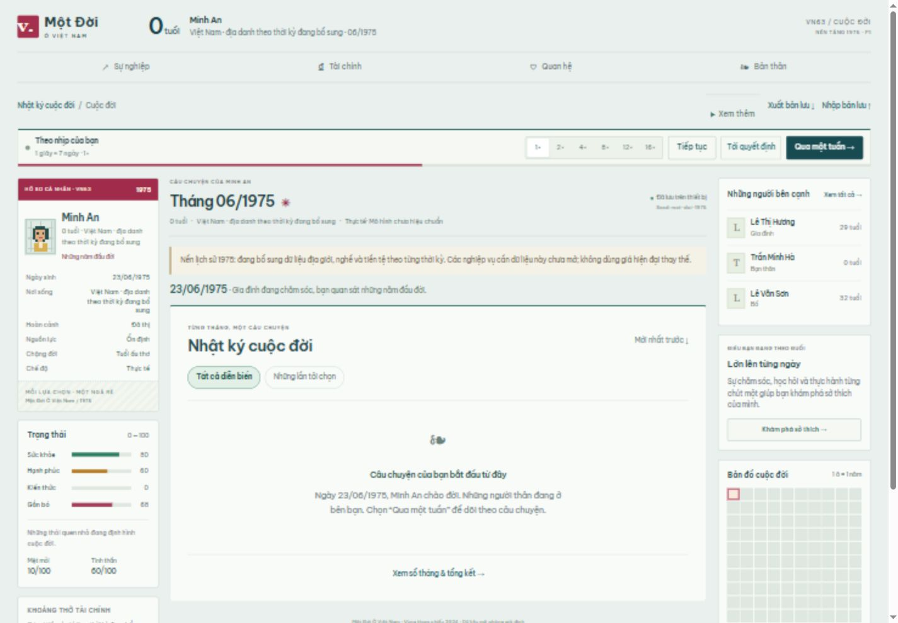

# P0/P1 — bằng chứng QA

Ngày 22/10/2026. Baseline main 80cc995; kết quả dưới đây là chạy thật, không phải acceptance toàn dự án.

## Baseline

- Content validator: PASS, 63 tên/ID ADMIN_NAMES_ONLY và fixtures demo; không xác nhận số liệu lịch sử.
- TypeScript và production static build: PASS.
- 49 unit/property/integration tests của main: PASS trước sửa.

## P1 core

- 59 tests / 8 files: PASS local, gồm 10 bài mới về seed/DOB 1975, week/month leap boundaries, pinning candidate, week target qua save/pause, 1×/16×, dưới 5, sinh nhật 5, guardian fallback, provenance/cutoff và chặn tiền/nghề không có dữ liệu.
- Regression các module v1.3 vẫn chạy, fixtures cũ ghi rõ `legacyDemo:true`, không vô tình biến các giả định đó thành dữ liệu 1975.
- Typecheck và production build: PASS local.
- Playwright: runner sandbox ban đầu spawn EPERM; sau khi chạy runner được cấp quyền và tải Chromium chính thức vào `work/`, 18 desktop/mobile cases PASS (19,1 giây), gồm xuất bản lưu nguyên bản trước chuyển đổi và thói quen qua sinh nhật 5 tuổi, tải lại không mất lựa chọn.
- Không dùng browser CLI failure do thiếu executable như kết quả pass. Các lỗi kỳ vọng cũ một bước = một tháng đã được cập nhật sang ngày thật của tick tuần, rồi chạy lại.

## Lifetime / cohort

- Legacy 1.000 full lives: PASS, 1.022.152 monthly ticks, 254.017 ms local (`qa-results/p1-legacy-1000.json`). Đây là regression cũ, không thay weekly smoke mới.
- `qa:p1 -- --count=1000`: PASS local, 1.000 cuộc đời, 4.500.340 tick tuần, 1.030.780 tháng đã đóng, 22.169 quyết định từ 5 tuổi trở lên, 609.956 ms. `guardianNotices=0` trong cohort này vì pack hiện tại không phát sự kiện cần chọn ở 0–4; đường xử lý pending caregiver cũ được kiểm tra bằng fixture riêng, không suy từ số 0 này rằng graph gia đình đã hoàn thiện. Kết thúc tuổi 75–95 là demo, không phân bố thực Việt Nam. Kết quả: `qa-results/p1-weekly-smoke.json`.
- Historical foundation smoke kiểm tra zero player prompt dưới 5, toàn bộ tuần/ngày được xử lý, monthly ledger/time conservation, roundtrip save và kết thúc có giới hạn; không hiệu chuẩn mortality/economics.
- CI trên PR chạy lại content/typecheck/unit/build/browser + P1 weekly smoke + 1.000 legacy lives + 60.000 doanh nghiệp (mỗi cấu hình 10k, 24 tháng). Trạng thái CI thực được liên kết trong PR.

## Chưa có bằng chứng / không nhận đã đạt

- 1976=38/2024=63/2025=34 mapping, luật tiền 1978/1985, real historical occupation gates, nguồn rủi ro bệnh/tử vong, regional differential calibration, household/graph 10k, future causal world.
- E2E một đời lịch sử đầy đủ qua đổi tiền/di cư/gia đình/thành tựu: chưa thể nghiệm thu ở P1.
- Chưa merge hoặc deploy production.

## Ảnh giao diện thực tế

